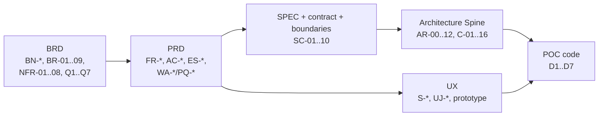
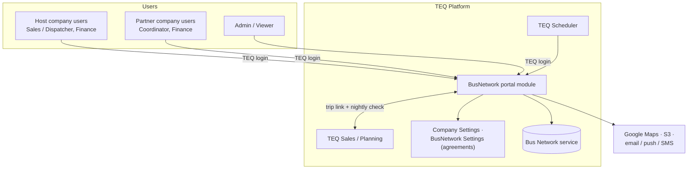
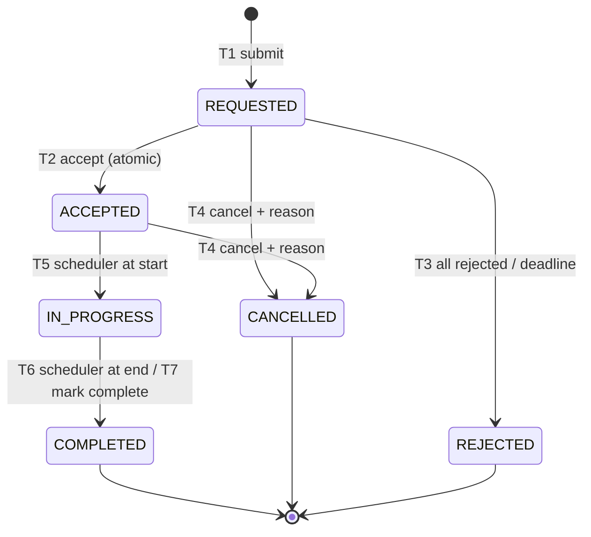
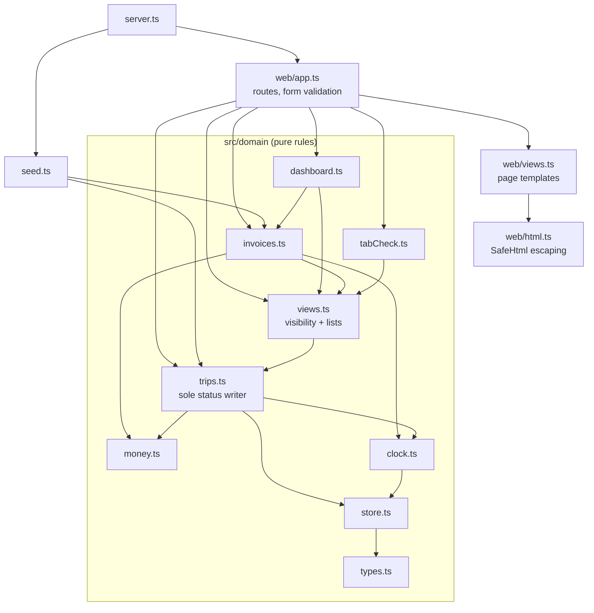

# BusNetwork — architecture overview

**Status:** current as of 2026-10-04 · **Authority:** this page summarises; it adds no requirement or rule. The binding sources are [planning-artifacts/brd/busnetwork-brd-v1/BRD.md](planning-artifacts/brd/busnetwork-brd-v1/BRD.md), [planning-artifacts/prd/busnetwork-prd-v1/PRD.md](planning-artifacts/prd/busnetwork-prd-v1/PRD.md), [specs/spec-busnetwork-v1-architecture/SPEC.md](specs/spec-busnetwork-v1-architecture/SPEC.md) and [planning-artifacts/architecture/architecture-BusNetwork-2026-08-26/ARCHITECTURE-SPINE.md](planning-artifacts/architecture/architecture-BusNetwork-2026-08-26/ARCHITECTURE-SPINE.md). Where this page and one of them differ, they win.

This page covers four things:

1. How the repository is laid out.
2. How the documents depend on each other.
3. The target architecture for R1.
4. How the POC maps onto that architecture.

---

## 1. Repository layout

```
BusNetwork/
├── README.md                     Start here: what this is, how to run it, where things are
├── docs/                         PRODUCT & DESIGN: BMAD output folder + project knowledge
│   ├── PROJECT-CONTEXT.md          One-page orientation            (project knowledge)
│   ├── ARCHITECTURE.md             This page                       (project knowledge)
│   ├── planning-artifacts/         BMAD planning outputs (BMM module)
│   │   ├── brd/busnetwork-brd-v1/
│   │   │   └── BRD.md                    BN-BRD-001 v1.0: business requirements (source of truth)
│   │   ├── prd/busnetwork-prd-v1/
│   │   │   ├── PRD.md                    BN-PRD-001 v2.0: product requirements, ACs, edge cases
│   │   │   └── VALIDATION-REPORT.md      Cross-document coherence audit
│   │   ├── architecture/architecture-BusNetwork-2026-08-26/
│   │   │   └── ARCHITECTURE-SPINE.md     BN-ARCH-001: invariants AR-00..12, components C-01..16
│   │   └── ux-designs/ux-busnetwork-2026-08-26/
│   │       ├── DESIGN.md                 Visual tokens, type, colour, status map
│   │       ├── EXPERIENCE.md             Behaviour, journeys UJ-*
│   │       ├── SCREENS.md                Every screen S-* and its states
│   │       └── prototype/                Clickable JS prototype (BusNetwork-Demo.html = built single file)
│   └── specs/spec-busnetwork-v1-architecture/   BMAD spec output
│       ├── SPEC.md                       BN-SPEC-001: capabilities SC-01..10
│       ├── data-sharing-contract.md      Field visibility, canonical codes, time/money, audit shape
│       └── v1-boundaries.md              Release slices R1 / R1.1 / Later
├── poc/                          CODE: throwaway TypeScript proof of concept
│   ├── src/domain/                 Business rules (no I/O)
│   ├── src/web/                    Express routes + HTML rendering
│   ├── src/seed.ts, src/server.ts  Demo data and entry point
│   └── test/                       Vitest: domain/ and web/
├── aidlc/                        PROCESS RECORD: AI-DLC workflow state and audit
│   └── spaces/default/
│       ├── memory/                   Team/project rules (org, team, project, phases)
│       └── intents/261004-poc/       The POC intent: requirements, plan, test results
├── _bmad/                        TOOLING: BMAD method install (config, modules, scripts)
│   └── custom/config.toml          Pins BMAD output to docs/ (survives reinstall)
├── .agents/skills/               TOOLING: BMAD skills (bmad-*) + shared skills
├── .claude/                      TOOLING: AI-DLC engine, agents, hooks, skills
│   └── skills/busnetwork/          Domain guide used by Claude for BusNetwork work
├── .puku-cli/                    TOOLING: local CLI settings
├── skills-lock.json              Pin list for the shared skills in .agents/skills
├── .mcp.json                     MCP server declarations
└── .gitignore
```

Each BMAD document folder also holds a hidden `.memlog.md`. This is BMAD's decision log for that document, recording why it says what it says. BMAD skills read it when they resume or edit the document, so keep it next to its document.

Four zones, each with one job:

| Zone | Owns | Written by | Changes when |
|---|---|---|---|
| `docs/` | The product definition | **BMAD method** (`bmad-prd`, `bmad-edit-prd`, `bmad-architecture`, `bmad-ux`, `bmad-spec`, …). BMAD's `output_folder` is `docs/`. | A business or design decision is taken. Edit the highest document that is affected, then the ones below it. |
| `poc/` | Code that shows the rules work | AI-DLC `poc` intent | The POC is extended. It never changes the docs. |
| `aidlc/` | The record of how the code was produced | AI-DLC engine | The AI-DLC workflow runs. Don't hand-edit it. |
| `_bmad/`, `.agents/`, `.claude/`, `.puku-cli/` | Tooling | Installers | Framework or skill updates. |

**Two methods, one hand-off.** BMAD produced the planning set: BRD → PRD → UX → SPEC → Architecture. AI-DLC turned it into code: intent → requirements → code generation → build and test. The hand-off point is `docs/`: AI-DLC reads the BMAD documents and never writes to them. Future BMAD outputs go to `docs/implementation-artifacts/` (epics, stories, sprint status) and `docs/test-artifacts/` (TEA test design, reviews, traceability). Both folders are created when first used.

---

## 2. Documentation architecture

The documents form a precedence chain. A lower document that contradicts a higher one has a defect, and the lower document is the one that gets fixed.



Text form: **BRD › PRD › SPEC › Architecture › UX › POC.**

- Cite documents by ID, not by wording or section number. Section numbers moved in PRD v2.0; PRD Appendix K maps them.
- Where the BRD is silent, the PRD adds a working assumption (`WA-nn`) and an open question (`PQ-nn`). The BRD text itself is not changed.
- The questions blocking R1 are BRD Q1–Q7, plus PQ-01, PQ-02, PQ-04, PQ-10 and PQ-15 (and PQ-13 for finance). See [specs/spec-busnetwork-v1-architecture/v1-boundaries.md](specs/spec-busnetwork-v1-architecture/v1-boundaries.md) §3 for what each one would move.

---

## 3. Target architecture (R1)

Full detail: [planning-artifacts/architecture/architecture-BusNetwork-2026-08-26/ARCHITECTURE-SPINE.md](planning-artifacts/architecture/architecture-BusNetwork-2026-08-26/ARCHITECTURE-SPINE.md).

### 3.1 Context

BusNetwork is a **feature module inside TEQ Platform**, not a separate system. It replaces four existing TEQ areas (*Sales › Network*, *Sales › Network Trips*, *Planning › BusNetwork Settings*, *Invoice › Claim Settlement*) with one six-tab portal: Dashboard, Request, Active Trips, Closed Trips, All Trips and Invoice List.



### 3.2 Layers and dependency rule

**Portal UI → application services → Bus Network service and integration adapters.**

- Dependencies point inward only. Services never call the UI, and adapters never contain business rules.
- **Only the trip lifecycle component (C-03) writes a status** (AR-01).
- Every rule is checked again on the server. The UI only presents.

| Layer | Components | Responsibility |
|---|---|---|
| Presentation | C-01 Portal UI | Shell, six tabs, list component, detail page, request form, invoice editor |
| Access | C-15 AuthZ & scope | Resolves user → company → roles → departments once. Every read path requires the resulting scope object. |
| Application | C-02 List query · C-03 Trip lifecycle · C-04 Request & share · C-05 Pricing · C-06 Comments · C-07 History & audit · C-08 Invoices · C-09 Notifications · C-11 Dashboard · C-12 Export | Business behaviour |
| Background | C-10 Scheduler jobs · C-14 Consistency check · C-16 Migration & analytics | Time-driven transitions, nightly comparison, legacy cutover |
| Integration | C-13 Adapters | TEQ Sales/Planning, Company Settings, BusNetwork Settings, Maps, S3, channels |
| Storage | Bus Network service | Shared trips, share requests, status changes, invoices |

### 3.3 Invariants that carry the business rules

These invariants are what hold the design together. Each one exists to prevent a specific failure.

| ID | Invariant | Protects |
|---|---|---|
| AR-00 | Do not invent TEQ Platform facts. Name the required property and defer the mechanism. | Everything |
| AR-01 | A trip has one stored status, written by one component | BR-01: status alone decides the tab |
| AR-02 | One query builder serves every list, count, badge and export | BN-ALL-03: Active + Closed = All |
| AR-03 | Accept is one atomic conditional write; other offers are withdrawn | BR-03: first accept wins |
| AR-04 | Authorization and department scope live in the query layer; there is no unscoped read | NFR-03, BR-09 |
| AR-05 | Fields a viewer may not see are left out of the server payload | BR-04, NFR-05 (partner never sees customer price) |
| AR-06 | Times in UTC; money in integer minor units; one rounding function | BR-07, BR-08 |
| AR-07 | The audit entry is written in the same transaction as the change | NFR-04 |
| AR-08 | Scheduler jobs and commands are idempotent | Retries and double clicks |
| AR-09 | Notifications go to an outbox and are sent after commit; they never block | An email outage cannot block an accept |
| AR-10 | An invoice is snapshotted at approve/decline | BN-INV-06/07 |
| AR-11 | Legacy screens keep their behaviour until replaced | Coexistence |
| AR-12 | The nightly consistency check flags differences and never overwrites | Data integrity |

### 3.4 Core lifecycle

Six trip statuses. Each status maps to exactly one list.



| List | Statuses |
|---|---|
| Active Trips | REQUESTED, ACCEPTED, IN_PROGRESS |
| Closed Trips | COMPLETED, CANCELLED, REJECTED |
| All Trips | All six |

Next to each trip there is one **share request** per partner (`PENDING / ACCEPTED / REJECTED / WITHDRAWN / EXPIRED`). A partner's view of a trip's status is derived from its own share request (PRD §6.2, PQ-01). Invoices follow their own lifecycle, I1–I6: Draft → Pending → Approved | Declined, and a declined invoice is resubmitted as a new version.

### 3.5 Still deferred (AR-00)

The following depend on TEQ Platform facts that are not in this workspace:

- Stack, framework, database and job runner
- The Bus Network service API and data model
- The concurrency mechanism for AR-03
- The search index, PDF library, and push/SMS APIs

Each is filled in once platform facts are available, without reopening the invariants. See the Spine's *Deferred* table.

---

## 4. POC architecture

Full detail: [../poc/README.md](../poc/README.md).

The POC is a standalone, in-memory Express app written in strict TypeScript. It shows that the rules hold for both host and partner users. It is **throwaway**: its simplifications are deliberate and must not be carried into R1 code. The deviation table is in `.claude/skills/busnetwork/SKILL.md` §2.

### 4.1 Module structure

Three layers. Domain code does no I/O and imports nothing from `web/`.



### 4.2 Mapping to target components

| POC module | Target component | Invariant it demonstrates |
|---|---|---|
| `domain/trips.ts` (`ALLOWED_TRANSITIONS`, `transition()`) | C-03 Trip lifecycle, C-04 Request & share | AR-01 single writer; AR-03 first accept wins |
| `domain/views.ts` | C-02 List query + C-15 scope | AR-02 one predicate per list; AR-04/05 visibility by company |
| `domain/money.ts` | C-05 Pricing | AR-06 one rounding function (as floats in the POC) |
| `domain/invoices.ts` | C-08 Invoices | AR-10 locked totals once approved |
| `domain/dashboard.ts` | C-11 Dashboard aggregates | — |
| `trips.advanceTime` + `domain/clock.ts` | C-10 Scheduler jobs | Transitions applied in order |
| `domain/tabCheck.ts` | No R1 component; R1 gets this by construction | Self-check of BN-ALL-03 |
| `Trip.history` | C-07 History & audit (partial) | Status changes only |
| `domain/store.ts` | Stands in for the Bus Network service | — |
| `web/*` | C-01 Portal UI | Server re-checks every action |
| *(not built)* | C-06 Comments, C-09 Notifications, C-12 Export, C-13 Adapters, C-14 Consistency, C-16 Migration | Out of POC scope |

### 4.3 Verification

Run these in `poc/`:

- `npm test`: 8 files, 44 tests (domain + HTTP).
- `npm run typecheck`: strict `tsc`.

Both passed on 2026-10-04.

---

## 5. Where new work goes

| You are… | Put it in | Then |
|---|---|---|
| Changing a business rule | `docs/planning-artifacts/brd/busnetwork-brd-v1/BRD.md` (or a `WA`/`PQ` in the PRD if the BRD is silent) | Use `bmad-edit-prd` / the matching BMAD skill so the change is recorded in that document's `.memlog.md`, then cascade down the precedence chain. |
| Adding a screen or behaviour | `docs/planning-artifacts/ux-designs/ux-busnetwork-2026-08-26/` | Cite `S-*`/`UJ-*` IDs. Rebuild the prototype with `python3 build-single-file.py`. |
| Changing an architectural rule | `docs/planning-artifacts/architecture/architecture-BusNetwork-2026-08-26/ARCHITECTURE-SPINE.md` | Update §3 of this page. |
| Extending the POC | `poc/src/domain/` for rules, `poc/src/web/` for HTTP/HTML, `poc/test/` mirroring both | Run `npm test` and `npm run typecheck`. |
| Starting R1 production code | A new top-level package, created once TEQ Platform conventions are known (AR-00) | Do not grow the POC into it. |
