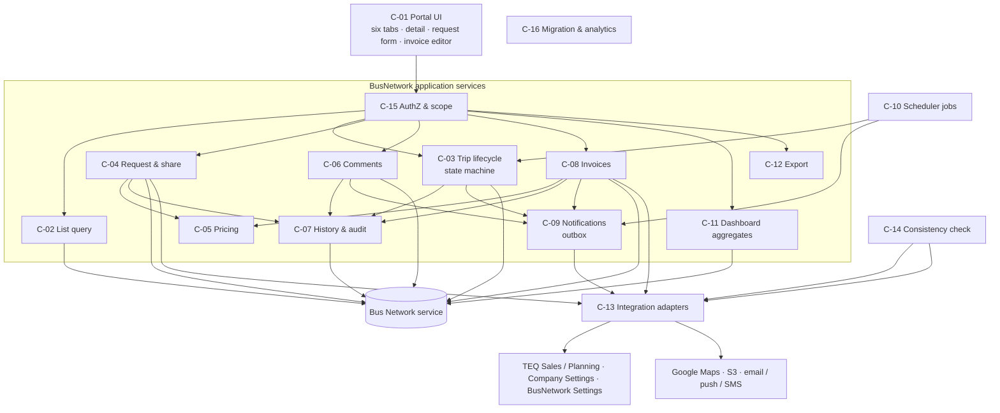
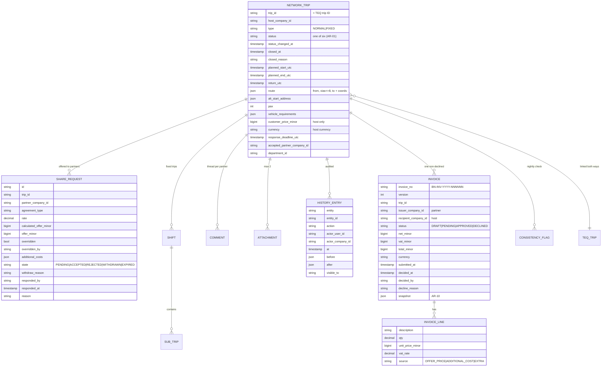
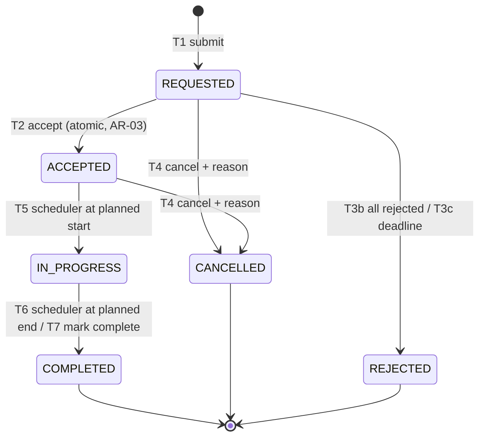

# Architecture Spine — BusNetwork portal

> **Status.** Final for the R1 scope. Invariants AR-01…AR-12 follow directly from the BRD's rules and NFRs and can be relied on now. Anything that depends on TEQ Platform internals is governed by AR-00 and listed under *Deferred*; those entries are filled in when the platform facts are read in, without reopening the invariants.

## Design paradigm

**A feature module inside TEQ Platform, layered as: portal UI → BusNetwork application services → Bus Network service and TEQ integrations.**

- The **portal UI** renders six tabs and a trip detail page from one list component and one action matrix (PRD §7.1, §7.4). It holds no business rules beyond presentation; every rule is re-checked on the server.
- The **application services** own business behaviour: one **trip state machine** is the only code that changes a trip status or a share-request state (AR-01); pricing and invoice arithmetic use one money utility (AR-06); authorization and department scope are applied in one query layer (AR-04).
- The **Bus Network service** stores shared trips, partner links, share requests, status changes and invoice data (BRD §13). TEQ Sales/Planning, Company Settings, BusNetwork Settings, Google Maps, the TEQ Scheduler and S3 are reached through adapters (C-13).

**Dependency rule.** UI → services → adapters/storage. Services never call the UI; adapters never contain business rules; no component other than C-03 writes a status.

## Inherited invariants

| Inherited | From | Binds here |
|---|---|---|
| Sign-in via TEQ's existing login | BRD §14 constraint, NFR-03 | C-01, C-15 |
| Roles and department scope work as elsewhere in TEQ | BRD §5, BR-09 | C-15 |
| Legacy *Sales › Network* screens unchanged until replaced | BRD §14 constraint | C-16, AR-11 |
| TEQ Platform architectural conventions (stack, service style, logging, i18n framework) | TEQ Platform — **not in this workspace** | All; see AR-00 |

## Invariants & rules

### AR-00 — Platform precondition

- **Binds:** everything below.
- **Prevents:** inventing TEQ Platform facts (stack, service APIs, legacy data model, auth primitives) and building against them.
- **Rule:** this workspace contains no TEQ Platform source, architecture spine or Bus Network service API description (verified 2026-08-26 and 2026-09-15). Where a rule here needs a platform mechanism, it names the *property* required and leaves the mechanism to the platform's own conventions. Any conflict with a TEQ Platform convention is raised as a conflict, not resolved locally.

### AR-01 — One status, one writer

- **Binds:** SC-05; BR-01, BRD §7, BN-CLS-06.
- **Prevents:** a trip appearing in both Active and Closed, or in neither; statuses changed by side paths (bulk jobs, migrations, admin tools) that skip guards, history or notifications.
- **Rule:** a trip has a single stored `status` from `data-sharing-contract.md` §3.1, and each share request a single `state` from §3.2. **Only C-03** changes them, and only through the transitions in PRD §6.3 (T1…T7). Each transition is one transaction that checks its guard, writes the new values, writes the history entry (AR-07) and enqueues notifications (AR-09). Transitions out of `COMPLETED`, `CANCELLED`, `REJECTED` don't exist.

### AR-02 — Lists add up by construction

- **Binds:** SC-02; BN-ALL-03, BN-LST-01…05, OBJ-5.
- **Prevents:** Active + Closed ≠ All because lists were built with different predicates, joins or scope rules.
- **Rule:** all trip lists, badges, dashboard counts and exports call **one** query builder (C-02) with the same filter object; the only difference between Active, Closed and All is the status set (`ACTIVE_SET`, `CLOSED_SET`, all). Company, department, direction, search and date predicates are applied identically. Counts and rows come from the same predicate. Company-view status for partners (PRD §6.2) is computed in that same builder.

### AR-03 — First accept wins atomically

- **Binds:** SC-05; BR-03, BN-ACT-07, BRD §14 risk.
- **Prevents:** two partners both holding an accepted trip.
- **Rule:** accept is a single conditional write: *set trip `ACCEPTED` and this request `ACCEPTED` where trip is `REQUESTED` and this request is `PENDING`*; if zero rows change, return `ALREADY_TAKEN` (or `EXPIRED`/`CANCELLED` from current state). In the same transaction all other `PENDING` requests become `WITHDRAWN(OTHER_PARTNER_ACCEPTED)`. The mechanism (row lock, optimistic version, conditional update) follows the Bus Network service's storage (AR-00).

### AR-04 — Authorization and scope in the query layer

- **Binds:** SC-09; NFR-03, BR-04, BR-09.
- **Prevents:** data leaking through an endpoint that forgot a check (exports, counts, badges, PDFs, notifications).
- **Rule:** every request passes C-15, which resolves user → company → roles → departments once and hands a **scope** object to services. C-02 and every read path require that scope; there is no unscoped read API. Role/side checks for actions use the PRD §7.4 matrix, defined once as data and used by both server enforcement and UI rendering. Out-of-scope reads return not-found.

### AR-05 — Field visibility by viewing company

- **Binds:** SC-06, SC-07, SC-09; BR-04, NFR-05.
- **Prevents:** a partner receiving the customer price, other partners' prices, or host-internal comments in an API payload the UI merely doesn't display.
- **Rule:** response mapping for trips, share requests, comments, history and invoices applies `data-sharing-contract.md` §2 on the server, based on the viewer's company and side. Fields not allowed are **absent** from the payload. Exports and PDFs use the same mappers. Notifications include only fields visible to the recipient.

### AR-06 — UTC time and minor-unit money

- **Binds:** SC-02, SC-04, SC-07; BR-07, BR-08, BN-LST-03, BN-LST-07.
- **Prevents:** off-by-one-day filters for other time zones; rounding differences between request pricing, invoices and exports.
- **Rule:** timestamps stored in UTC; one shared utility converts user-zone day ranges to UTC ranges and formats `YYYY-MM-DD HH:MM` / `Xh Ym`. Money stored as integer minor units + currency; one shared function implements half-away-from-zero rounding to 2 decimals and the formulas in `data-sharing-contract.md` §4.

### AR-07 — Audit in the same transaction

- **Binds:** SC-05, SC-06, SC-07; NFR-04, BN-DTL-05, BN-REQ-05.
- **Prevents:** state changes with no history, or history for changes that rolled back.
- **Rule:** C-07 writes the entry (`data-sharing-contract.md` §5) in the same transaction as the change. Entries are append-only (no update/delete API) and retained 5 years. The trip detail history is a filtered read of these entries.

### AR-08 — Idempotent scheduler and commands

- **Binds:** SC-05, SC-08; BRD §13 *TEQ Scheduler*; PRD DR-08.
- **Prevents:** duplicate transitions or notifications from job retries, double clicks or network retries.
- **Rule:** scheduler jobs (C-10) select by state and time and apply transitions through C-03, so a re-run finds nothing to do. State-changing commands accept an idempotency key; a repeat with the same key returns the first result. Job lateness > 5 minutes raises an alert.

### AR-09 — Notifications after commit, never blocking

- **Binds:** SC-08; BRD §11; PRD DR-09.
- **Prevents:** an email outage blocking an accept; notifications for changes that rolled back; duplicates.
- **Rule:** transitions write notification intents to an outbox in their transaction; C-09 delivers after commit per channel (in-app, email, push, SMS where enabled), in the recipient company's locale, with retries and a per-intent dedupe key. Failures are logged and visible to operations; they never change trip or invoice state.

### AR-10 — Invoice snapshot at decision

- **Binds:** SC-07; BN-INV-06, BN-INV-07.
- **Prevents:** approved or declined invoices changing when the trip's price or VAT settings change later.
- **Rule:** at Approve/Decline, C-08 stores the lines, VAT and totals as an immutable snapshot on that invoice version; list, PDF, export and dashboard sums read the snapshot. Resubmitting a Declined invoice creates a new version; earlier versions stay read-only.

### AR-11 — Coexistence without changing legacy behaviour

- **Binds:** SC-10; BRD §14 constraint.
- **Prevents:** portal work silently altering *Sales › Network* screens before replacement.
- **Rule:** portal-specific data (six-status mapping, per-user read state, drafts, reason catalogue, consistency flags) lives in portal-owned structures or additive fields; any change to shared Bus Network service behaviour is backward compatible with the legacy screens and covered by their regression tests.

### AR-12 — Consistency check flags, never overwrites

- **Binds:** SC-10; BRD §14 risk.
- **Prevents:** a nightly job quietly overwriting the partner's copy with a mistaken TEQ edit (or vice versa).
- **Rule:** C-14 compares the fields listed in `data-sharing-contract.md` §1 and writes consistency flags only. Resolution is by a user action (Edit while Requested, BR-05 price change, or a TEQ-side correction), after which the next check clears the flag.

## Consistency conventions

| Concern | Convention |
|---|---|
| Enumerations | Upper snake case codes from `data-sharing-contract.md` §3; labels via i18n keys `bn.status.REQUESTED` etc. |
| IDs | Trip ID = TEQ trip ID; invoice `BN-INV-YYYY-NNNNNN` + version; share request and comment IDs opaque |
| Times | UTC storage; user-zone display via AR-06 utility only |
| Money | Minor units + ISO 4217; AR-06 function only |
| Errors | Typed, user-actionable codes mapped to PRD §12 messages: `ALREADY_TAKEN`, `REQUEST_EXPIRED`, `REQUEST_CANCELLED`, `TRIP_CLOSED`, `NOT_ALLOWED`, `NOT_FOUND`, `INVOICE_EXISTS`, `TRIP_NOT_COMPLETED`, `VALIDATION_FAILED(field, message)` |
| Action matrix | One declarative table (status × side × action → roles) shared by UI and server (AR-04) |
| i18n | All strings, reason labels, notification templates and PDF templates externalised for nb_NO (default), en_US, sv_SE, da_DK (NFR-06) |
| Logging | Structured logs with trip ID / invoice no. and correlation ID on every state change; no customer personal data in logs (NFR-05) |
| Accessibility | Component library meets WCAG 2.1 AA; automated checks in CI (NFR-07) |
| Configuration | Per-company: reason catalogue, notification channels (push/SMS), deadline default (Q6), auto-complete switch (Q5) |

## Stack

**UNKNOWN — inherit from TEQ Platform.** No platform code or stack description is in this workspace (AR-00). The portal uses whatever web framework, service style, database and job runner TEQ uses for comparable modules.

## Structural seed

### Components

| ID | Component | Responsibility | Carries |
|---|---|---|---|
| C-01 | Portal UI | Shell, tabs, badges, list component, detail page, request form, invoice editor, modals | SC-01, BN-LST-06/07/08/10, BN-REQ-10 |
| C-02 | List query | One query builder for trip lists, counts, badges, invoice list; company-view status; paging; search index | SC-02, AR-02 |
| C-03 | Trip lifecycle | State machine T1…T7; action matrix enforcement; accept atomicity; BR-05 price change | SC-05, AR-01, AR-03 |
| C-04 | Request & share | Form steps, prefill from TEQ, drafts, partner picker, submit, edit, TEQ back-link, quick share | SC-04 |
| C-05 | Pricing | Offer price formulas, overrides, additional costs, rounding | BN-REQ-05/06, AR-06 |
| C-06 | Comments | Threads per host↔partner, read state | BN-DTL-04 |
| C-07 | History & audit | Append-only entries, retention, visibility filter | NFR-04, AR-07 |
| C-08 | Invoices | Lifecycle I1…I6, numbering, lines, VAT, snapshot, archive, PDF | SC-07, AR-10 |
| C-09 | Notifications | Outbox, N-01…N-08 templates, channels, locale, retries | SC-08, AR-09 |
| C-10 | Scheduler jobs | Start, complete, expire, 2-hour warning | BRD §13, AR-08 |
| C-11 | Dashboard aggregates | Key figures, upcoming, needs-your-action, charts; ≤ 5-min cache | SC-03 |
| C-12 | Export | CSV/XLSX streaming from C-02; status-history sheet | BN-LST-09, BN-ALL-06 |
| C-13 | Integration adapters | TEQ Sales/Planning, Company Settings, BusNetwork Settings, Google Maps, S3, channels | BRD §13 |
| C-14 | Consistency check | Nightly compare and flag | AR-12 |
| C-15 | AuthZ & scope | Login context, roles, departments, scope object, side checks | SC-09, AR-04, AR-05 |
| C-16 | Migration & analytics | Legacy mapping, trial reconciliation, TM events, M-1…M-5 | SC-10, PRD §14–§15 |

### Core entities

### Trip state machine (owned by C-03)

### Capability → component map

| Capability | Components | Governed by |
|---|---|---|
| SC-01 Portal shell | C-01, C-15, C-11 (badges) | AR-04 |
| SC-02 Lists | C-02, C-12, C-01 | AR-02, AR-04, AR-06 |
| SC-03 Dashboard | C-11, C-02 | AR-02, AR-04 |
| SC-04 Request | C-04, C-05, C-13 | AR-01, AR-06, AR-07 |
| SC-05 Lifecycle | C-03, C-10 | AR-01, AR-03, AR-07, AR-08, AR-09 |
| SC-06 Detail | C-01, C-06, C-07 | AR-05, AR-07 |
| SC-07 Invoices | C-08, C-05, C-13 | AR-06, AR-07, AR-10 |
| SC-08 Notifications | C-09 | AR-08, AR-09 |
| SC-09 Access | C-15 | AR-04, AR-05 |
| SC-10 Migration | C-16, C-14 | AR-11, AR-12 |

## Non-functional tactics

| NFR | Tactic |
|---|---|
| NFR-01 lists < 2 s p95 @ 50 000 trips; dashboard < 3 s | Composite indexes on (company, status, planned_start), (company, closed_at), (partner company, request state); search index on Trip ID, from/to address, company name, group ref.; keyset-friendly stable sort with Trip ID tiebreak; dashboard aggregates cached ≤ 5 min per company+department scope (also satisfies BN-DSH-08); export streamed |
| NFR-02 99.5% 06:00–22:00 CET | Stateless UI/services behind TEQ's standard deployment; scheduler jobs catch up idempotently after outages (AR-08); synthetic monitoring |
| NFR-03 ISO 27001, TEQ login, per-call checks | AR-04; attachment malware scan before sharing; signed, expiring S3 URLs for downloads |
| NFR-04 audit 5 years | AR-07; retention policy on the audit store |
| NFR-05 GDPR | AR-05 field filtering; no personal data in logs or analytics events; DPIA for PRD WA-08 |
| NFR-06 four locales | Externalised strings; locale-aware formatting; notification and PDF templates per locale; recipient-company locale for messages |
| NFR-07 WCAG 2.1 AA | Accessible component library; status pills with text; keyboard alternatives for drag reorder and hover tooltips; axe in CI |
| NFR-08 browsers, 1280→768 px | Responsive layout; tables scroll inside their container below 1024 px; E2E matrix on latest two Chrome/Edge/Firefox/Safari |

## Deferred

| Item | Why deferred | Revisit when |
|---|---|---|
| Stack, framework, database, job runner | TEQ Platform not in workspace (AR-00) | Platform conventions are shared with the team |
| Bus Network service API and data model | Not in workspace; needed for C-02/C-03 mechanics and migration | D-1 delivered (PRD §16) |
| Legacy active/archive and claim attribute names | Needed to finalise PRD §15.2 mapping | Trial migration preparation |
| Concurrency mechanism for AR-03 | Depends on the service's storage | Service API known |
| Search index technology | Depends on platform standard | Stack known |
| Push and SMS channel APIs | TEQ channels assumed to exist (D-3) | Channel owners confirm |
| PDF rendering library | Platform standard | Stack known |
| Q1–Q7 and blocking PQs | Business decisions (PRD §17) | Decisions recorded; see `v1-boundaries.md` §3 for impact |
