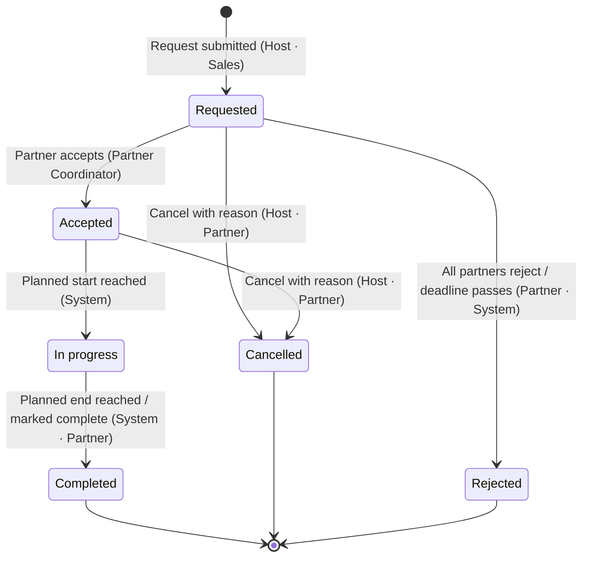

> **Source of truth.** This file is the repository copy of the BusNetwork BRD artifact **BN-BRD-001** (link in frontmatter). Its sections, requirement IDs, priorities and wording follow that artifact exactly. If this file and the artifact ever differ, the artifact wins and this file is corrected.
>
> **Requirement-ID rule.** Requirement IDs stay the same between versions; if a requirement is removed it is marked withdrawn and its ID isn't reused. Downstream documents (PRD, SPEC, Architecture, UX, tests) cite these IDs, not the wording.

# BusNetwork — Business Requirements Document

The BusNetwork portal lets bus operators share trips with partner companies, follow each trip until it's finished, and settle what each side owes. This document sets out what the portal must do, organised around its six main tabs.

| Document ID | Version | Date | Status | Product | Classification |
|---|---|---|---|---|---|
| `BN-BRD-001` | 1.0 — Final | 16 Sep 2026 | Final · open questions Q1–Q7 tracked (§15) | TEQ · BusNetwork | Internal |

## Contents

1. [Executive summary](#1-executive-summary)
2. [Background & problem statement](#2-background--problem-statement)
3. [Business objectives & success metrics](#3-business-objectives--success-metrics)
4. [Scope](#4-scope)
5. [Stakeholders & user roles](#5-stakeholders--user-roles)
6. [Glossary](#6-glossary)
7. [Navigation & trip lifecycle](#7-navigation--trip-lifecycle)
8. [Shared list behaviour](#8-shared-list-behaviour)
9. [Functional requirements](#9-functional-requirements) — [9.1 Dashboard](#91-dashboard) · [9.2 Request](#92-request) · [9.3 Active Trips](#93-active-trips) · [9.4 Closed Trips](#94-closed-trips) · [9.5 All Trips](#95-all-trips) · [9.6 Invoice List](#96-invoice-list)
10. [Business rules](#10-business-rules)
11. [Notifications](#11-notifications)
12. [Non-functional requirements](#12-non-functional-requirements)
13. [Integrations & dependencies](#13-integrations--dependencies)
14. [Assumptions, constraints & risks](#14-assumptions-constraints--risks)
15. [Open questions](#15-open-questions)
16. [Revision history & approval](#16-revision-history--approval)

---

## 1. Executive summary

Bus operators often get more trip requests than their fleet can handle, or get a trip in an area where they have no vehicles. Today, companies on TEQ hand this work to each other through Bus Network. The tools for it are spread across four areas: *Sales › Network*, *Sales › Network Trips*, *Planning › BusNetwork Settings* and *Invoice › Claim Settlement*.

BusNetwork brings this work into one portal with a single navigation bar: **Dashboard**, **Request**, **Active Trips**, **Closed Trips**, **All Trips** and **Invoice List**. Each trip has one lifecycle, and that lifecycle decides which tab the trip appears in. As a result, the lists always add up: *Active + Closed = All*.

---

## 2. Background & problem statement

The current network features already cover the core exchange. A **host company** shares normal or fixed trips with one or more **partner companies**. Each partner is offered a price based on its agreement (percentage, full day or half day). The partner accepts or rejects, and closed trips are later settled through claims. The problems are about how people use these features:

- **Fragmented navigation.** Sharing, tracking and settlement sit in three different modules. Users can't see one trip from start to finish in one place.
- **No overview.** There is no single screen that shows trips waiting for a response, trips running today, or claims waiting for approval.
- **Unclear trip status.** The current lists use "active" and "archive" tabs whose meaning differs between screens. Users can't easily tell whether a trip is still open.
- **Settlement is separate from trips.** Claims are managed apart from the trips they belong to, so it's hard to check what is owed for a given trip.

---

## 3. Business objectives & success metrics

| ID | Objective | Success metric | Target |
|---|---|---|---|
| OBJ-1 | Make it faster to hand a trip to a partner | Median time from creating a request to partner acceptance | −30% within 6 months |
| OBJ-2 | Reduce lost revenue from requests nobody answers | Share of requests that expire with no response | < 10% |
| OBJ-3 | Speed up settlement between companies | Median days from trip closed to invoice approved | ≤ 7 days |
| OBJ-4 | Give users one place to work | Network tasks done without leaving the portal | ≥ 90% |
| OBJ-5 | Make lists trustworthy | Support tickets about a trip's status or a missing trip | −50% within 6 months |

---

## 4. Scope

| In scope | Out of scope (this release) |
|---|---|
| A portal shell with the six-tab navigation | Managing partner agreements and rates (stays in *BusNetwork Settings*) |
| A dashboard with key figures, trips starting soon and actions waiting on the user | Assigning vehicles and drivers to trips (stays in Planning) |
| Creating and sharing normal and fixed trips with partners (Request) | Posting invoices to accounting systems such as Fortnox or SIE4 |
| Active, Closed and All Trips lists, plus a trip detail page | Collecting payments and reconciling payments received |
| Partner responses: accept, reject and cancel, each with a reason | Customer-facing booking portal changes |
| Comment threads on each trip | A mobile driver app |
| An Invoice List of incoming and outgoing invoices for closed trips, with approve and decline | |
| Notifications for events in the trip and invoice lifecycles | |

---

## 5. Stakeholders & user roles

A company can be a host on one trip and a partner on another. Roles belong to a user within a company, and what a user can see is limited by their departments. This works the same way as permissions elsewhere in TEQ.

| Role | Description | Main tabs |
|---|---|---|
| **Sales / Dispatcher** | Creates requests, chooses partners, sets offer prices, and follows trips they have shared with others. | Dashboard, Request, Active, All |
| **Partner Coordinator** | Handles incoming requests from other companies: accepts, rejects or comments, and follows accepted trips until they close. | Dashboard, Active, Closed |
| **Finance User** | Checks and approves or declines invoices, and follows amounts that are still unpaid. | Dashboard, Closed, Invoice List |
| **Company Admin** | Sets up users, permissions and default settings for BusNetwork. | All |
| **Viewer / Management** | Read-only access to the dashboard and lists for monitoring. | Dashboard, All |

### Permission matrix

| Action | Sales | Partner Coord. | Finance | Admin | Viewer |
|---|---|---|---|---|---|
| View dashboard | ✓ | ✓ | ✓ | ✓ | ✓ |
| Create / share request | ✓ | — | — | ✓ | — |
| Accept / reject incoming request | — | ✓ | — | ✓ | — |
| Cancel trip (with reason) | ✓ | ✓ | — | ✓ | — |
| Comment on trip | ✓ | ✓ | ✓ | ✓ | — |
| Approve / decline invoice | — | — | ✓ | ✓ | — |
| Export lists | ✓ | ✓ | ✓ | ✓ | ✓ |

---

## 6. Glossary

| Term | Definition |
|---|---|
| **Host company** | The company that owns the customer booking and shares the trip. Called "Contractor" in the current lists. |
| **Partner company** | The company that receives the request and runs the trip. Called "Subcontractor" or "target company" today. |
| **Affiliation** | An accepted partnership between two companies. Only affiliated partners can receive requests. |
| **Price agreement** | How the partner's offer price is worked out: `percentage`, `full_day`, `half_day` or none. |
| **Customer price** | What the host charges its own customer for the trip. |
| **Offer price** | What the host offers to pay the partner for running the trip. |
| **Normal trip** | A single booked trip with a route of from, up to 8 via stops, and to. |
| **Fixed trip** | A recurring or contract trip made up of shifts and sub-trips. |
| **Trip ID** | The trip reference shown to users (the TEQ trip ID). It is the same in both companies' views. |
| **PAX** | Number of passengers. |
| **Invoice / claim** | A request for payment raised for a closed trip, from the partner to the host. The current Claim Settlement screens call this a "claim". |

---

## 7. Navigation & trip lifecycle

The portal has one top-level navigation bar, always in the same order. Tabs that list trips show a count in a badge. Every tab respects the user's permissions and department scope. Tabs a user can't open are hidden, not shown as disabled.

```
┌──────────────┬───────────┬─────────┬──────────────────┬──────────────┬───────────┬────────────────┐
│ ● BusNetwork │ Dashboard │ Request │ Active Trips (24)│ Closed Trips │ All Trips │ Invoice List (3)│
└──────────────┴───────────┴─────────┴──────────────────┴──────────────┴───────────┴────────────────┘
```

*Illustrative. Badge counts: Active Trips shows open trips, and Invoice List shows invoices waiting for the user's approval.*

| Tab | Purpose | Contains | Badge |
|---|---|---|---|
| **Dashboard** | Landing page and summary | Key figures, trips starting soon, actions waiting, recent activity | — |
| **Request** | Create and share a new trip | Step-by-step creation form | — |
| **Active Trips** | Work on open trips | Status: Requested, Accepted, In progress | Open trips |
| **Closed Trips** | Review finished trips | Status: Completed, Cancelled, Rejected | — |
| **All Trips** | Search all trips | Every status (Active + Closed) | — |
| **Invoice List** | Settle completed trips | Incoming and outgoing invoices | Waiting for approval |

### Where a trip appears

A trip has exactly one status at a time. The status alone decides which list shows the trip, so a trip is never in both Active and Closed, and never missing from All.

| List | Status | Meaning |
|---|---|---|
| Active Trips | **Requested** | Shared, waiting for the partner to respond |
| Active Trips | **Accepted** | Partner confirmed; trip hasn't started |
| Active Trips | **In progress** | Between the planned start and end time |
| Closed Trips | **Completed** | Trip finished; can be invoiced |
| Closed Trips | **Cancelled** | Withdrawn by host or partner |
| Closed Trips | **Rejected** | Partner declined or request expired |
| **All Trips** | all six | Active + Closed |

#### Status changes

| From | Event | To | Triggered by |
|---|---|---|---|
| — | Request submitted to one or more partners | **Requested** | Host (Sales) |
| **Requested** | Partner accepts | **Accepted** | Partner Coordinator |
| **Requested** | All partners reject, or the response deadline passes | **Rejected** | Partner / System |
| **Requested**, **Accepted** | Host or partner cancels with a reason | **Cancelled** | Host / Partner |
| **Accepted** | Planned start time is reached | **In progress** | System |
| **In progress** | Planned end time is reached, or the trip is manually marked complete | **Completed** | System / Partner |



---

## 8. Shared list behaviour

Active Trips, Closed Trips, All Trips and Invoice List use the same list component. The requirements below apply to all four, and each module section only lists what's different.

| ID | Requirement | Priority |
|---|---|---|
| BN-LST-01 | Lists load one page at a time (default 25 rows; options 10 / 25 / 50 / 100) and show the total number of matching rows. | Must |
| BN-LST-02 | A free-text search matches Trip ID, from/to address, company name and group reference. | Must |
| BN-LST-03 | A date range filter applies to trip start. "From" counts from 00:00:00 and "To" counts up to 23:59:59, both in the user's time zone. | Must |
| BN-LST-04 | Users can filter by company, with an "All companies" default, showing partners or hosts depending on which side of the trip the user is on. | Must |
| BN-LST-05 | Users can sort by Trip ID, trip start, trip length, PAX and price. The default sort is trip start, soonest first on Active Trips and most recent first on the other lists. | Must |
| BN-LST-06 | Filters, sort and page number stay in the URL, so a filtered view can be bookmarked or shared. | Should |
| BN-LST-07 | Dates and times are stored in UTC and shown in the user's time zone as `YYYY-MM-DD HH:MM`. Trip length is shown as `Xh Ym`. | Must |
| BN-LST-08 | When a list is empty, it says why (for example "No active trips match these filters") and offers to clear the filters. | Must |
| BN-LST-09 | Users can export the current filtered view to CSV and XLSX. | Should |
| BN-LST-10 | Selecting a row opens the trip detail page. Coming back restores the list's filters and scroll position. | Must |

### Standard trip columns

| Column | Content | Active | Closed | All |
|---|---|---|---|---|
| Trip ID | Trip reference | ✓ | ✓ | ✓ |
| Trip start | Planned start date and time | ✓ | ✓ | ✓ |
| Trip length | Planned duration, e.g. `6h 30m` | ✓ | ✓ | ✓ |
| From – To | Start and end address; via stops shown on hover | ✓ | ✓ | ✓ |
| PAX | Passenger count | ✓ | ✓ | ✓ |
| Shift | Shift name for fixed trips; "N/A" for normal trips | ✓ | ✓ | ✓ |
| Company | The other company on the trip (host or partner) | ✓ | ✓ | ✓ |
| Type | Trip type, e.g. NORMAL or FIXED | ✓ | ✓ | ✓ |
| Price | Offer price in the company currency | ✓ | ✓ | ✓ |
| Status | Status label (see §7) | ✓ | ✓ | ✓ |
| Comments | Number of comments, with unread ones highlighted | ✓ | ✓ | ✓ |
| Closed date | When the trip reached a closed status | — | ✓ | ✓ |
| Invoice | Invoice status, linked to the invoice | — | ✓ | ✓ |
| Actions | Actions available for the status and role | ✓ | ✓ | ✓ |

---

## 9. Functional requirements

Priorities use MoSCoW: **Must** · **Should** · **Could**. Requirement IDs stay the same between versions of this document, so tickets and test cases can refer to them.

### 9.1 Dashboard

*BusNetwork › Dashboard*

The Dashboard is the landing page. It answers three questions in order: what needs my action now, what is running soon, and how is the network doing?

**Illustrative layout** (wireframe of the layout only; not a visual design):

```
┌───────────────────┬───────────────┬──────────────────────┬───────────────────┬───────────────┐
│ AWAITING RESPONSE │ ACTIVE TRIPS  │ STARTING NEXT 7 DAYS │ CLOSED THIS MONTH │ OPEN INVOICES │
│ Requests waiting  │ Accepted +    │ Trip count           │ Completed trips   │ Amount pending│
│ on us             │ in progress   │                      │                   │               │
├───────────────────┴───────────────┴──────────────────────┼───────────────────┴───────────────┤
│ UPCOMING TRIPS                                           │ NEEDS YOUR ACTION                 │
│ Next 10 trips by start time: Trip ID, start, route, PAX, │ Incoming requests, cancellations, │
│ company, status                                          │ invoices to approve, unread       │
│                                                          │ comments                          │
├──────────────────────────────────────────────────────────┼───────────────────────────────────┤
│ TRIP VOLUME — shared vs received per week, last 12 weeks │ TOP PARTNERS — by completed trips │
└──────────────────────────────────────────────────────────┴───────────────────────────────────┘
```

| ID | Requirement | Priority |
|---|---|---|
| BN-DSH-01 | Show key figures: requests awaiting response, active trips, trips starting in the next 7 days, trips closed this month, and the total amount of open invoices. | Must |
| BN-DSH-02 | Selecting a key figure opens the matching list with its filters already applied. For example, "Awaiting response" opens Active Trips filtered to Requested. | Must |
| BN-DSH-03 | Show the next 10 upcoming trips (Accepted or In progress) sorted by start time, with a link to each trip's detail page. | Must |
| BN-DSH-04 | Show a "Needs your action" list of items waiting on the user's role: incoming requests, cancellations, invoices to approve, and unread comments. | Must |
| BN-DSH-05 | A period selector (This week, This month, Last 30 days, Custom) changes the period-based figures and charts. | Should |
| BN-DSH-06 | Show a weekly trip volume chart (shared vs received) for the last 12 weeks. | Should |
| BN-DSH-07 | Show the top 5 partner companies by completed trips in the selected period. | Could |
| BN-DSH-08 | Dashboard data is no more than 5 minutes old, and the page shows when it was last updated. | Must |

### 9.2 Request

*BusNetwork › Request*

The Request tab is where users create a new trip and share it with partner companies. It uses a four-step form, and users can go back to an earlier step without losing what they entered. Users can also share existing TEQ trips (normal or fixed) from other screens, which opens this form already filled in.

1. **Trip details.** Customer, trip type, route, dates and times, PAX, vehicle requirements, comments and attachments.
2. **Select partners.** Choose one or more affiliated partner companies. Each partner's price agreement and rate is shown.
3. **Set price.** Check the customer price and the offer price calculated for each partner, and change it where needed.
4. **Review & submit.** A read-only summary; submitting sends the request and sets the trip to **Requested**.

#### Trip details fields

| Field | Rule | Required |
|---|---|---|
| Trip type | Normal or Fixed | Yes |
| Customer & contact person | Search existing customers, or create one without leaving the form | Yes |
| Travel from / to | Google Maps address autocomplete; must resolve to map coordinates | Yes |
| Via stops | Up to 8, in order, can be dragged to reorder | No |
| Planned start / end | End must be after start; start must be in the future | Yes |
| Return date/time | Required for round trips | Conditional |
| PAX | Whole number ≥ 1; must not exceed the capacity of the selected vehicle type | Yes\* |
| Vehicle requirements | Vehicle type, Euro class, fuel type, luggage, other requirements | No |
| Shifts | Fixed trips only: one or more shifts with sub-trips | Conditional |
| Flight no. / Group ref. / Sign | Free text | No |
| Comments | Separate fields: to partner, to driver, HQ, invoice comment, invoice reference | No |
| Attachments | Up to 2 files, max 10 MB each (PDF, JPG, PNG, DOCX) | No |

\* PAX may be left empty on fixed trips where passenger count is turned off.

#### Offer price calculation

Each selected partner gets its own offer price, worked out from its price agreement. The result uses standard rounding.

```
percentage   offer price = customer price × rate ÷ 100
full_day     offer price = agreed full-day rate
half_day     offer price = agreed half-day rate
no agreement offer price = 0 → user must enter a price before submitting

Example: customer price NOK 20 000, percentage agreement at 85 %
             offer price = 20 000 × 85 ÷ 100 = NOK 17 000
```

| ID | Requirement | Priority |
|---|---|---|
| BN-REQ-01 | Create normal and fixed trips using the four-step form above. A step can only be completed when its required fields are filled in correctly. | Must |
| BN-REQ-02 | Save the request as a draft at any step, and pick it up again later from the Request tab. | Should |
| BN-REQ-03 | The partner picker shows only companies with an *accepted* affiliation. It shows each partner's name, category, price agreement and rate, and can be searched and sorted by name. | Must |
| BN-REQ-04 | Users can select several partners for one request. Each partner receives its own offer price. | Must |
| BN-REQ-05 | Calculate each partner's offer price using the formula above. Users can override it, and the override is recorded along with the user's name. | Must |
| BN-REQ-06 | Users can add an additional cost for each partner (for example tolls or ferries), shown separately from the offer price. | Should |
| BN-REQ-07 | "Quick share" skips steps 2–3 for users with a default partner, using that partner's agreement price without changes. | Could |
| BN-REQ-08 | Users can set a response deadline. If no partner has accepted by then, the request moves to **Rejected** with the reason "Expired". | Should |
| BN-REQ-09 | After submission, show the new trip's Trip ID and link to it in Active Trips. Also link the trip back to the original TEQ trip, so it's marked as shared in both places. | Must |
| BN-REQ-10 | Error messages say which field is wrong and how to fix it, for example "End time must be after start time (start 2026-09-20 08:00)". | Must |

### 9.3 Active Trips

*BusNetwork › Active Trips*

Shows every open trip: **Requested** · **Accepted** · **In progress**. This is where host and partner users do their day-to-day work on trips.

| ID | Requirement | Priority |
|---|---|---|
| BN-ACT-01 | List all trips with status Requested, Accepted or In progress, using the shared list behaviour (§8) and the standard columns. | Must |
| BN-ACT-02 | A direction filter lets users choose All, Shared by us (host) or Received by us (partner). | Must |
| BN-ACT-03 | A status filter lets users pick one or more of the three active statuses. | Must |
| BN-ACT-04 | Row actions depend on status and role. Requested and received: *Accept*, *Reject*. Requested and shared: *Edit*, *Cancel*. Accepted: *Cancel*, *Comment*. In progress: *Comment*, *Mark complete*. | Must |
| BN-ACT-05 | Reject and Cancel require a reason, chosen from a list or entered as free text. The reason is shown to the other company. | Must |
| BN-ACT-06 | When the partner accepts, the host is notified. The partner can then turn the trip into a quotation in its own TEQ account. | Must |
| BN-ACT-07 | When a request went to several partners, the first partner to accept gets the trip. The other partners' requests are withdrawn and they are notified. | Must |
| BN-ACT-08 | Trips starting within 24 hours that are still **Requested** are clearly flagged in the list. | Should |
| BN-ACT-09 | Users can accept or reject several received requests at once, using the same reason for all. | Could |

#### Trip detail page (shared by all trip tabs)

| ID | Requirement | Priority |
|---|---|---|
| BN-DTL-01 | Show the header (Trip ID, status, type, host, partner), the route with a map, the schedule, PAX, vehicle requirements, pricing, attachments and all comment fields. | Must |
| BN-DTL-02 | If the partner has entered an alternative start address, show it instead of the original start address. | Must |
| BN-DTL-03 | Fixed trips show their shift details and sub-trips. | Must |
| BN-DTL-04 | A comment thread between host and partner, with author, company and time on each comment. New comments send a notification to the other company. | Must |
| BN-DTL-05 | A history log of every status change, price change and edit, with who made it and when. | Must |
| BN-DTL-06 | The actions available match those in the list for the same status and role (BN-ACT-04). | Must |

### 9.4 Closed Trips

*BusNetwork › Closed Trips*

Shows trips that have finished: **Completed** · **Cancelled** · **Rejected**. Trips here are read-only, except for comments and starting an invoice.

| ID | Requirement | Priority |
|---|---|---|
| BN-CLS-01 | List all trips with status Completed, Cancelled or Rejected, using the shared list behaviour (§8) and the Closed columns. | Must |
| BN-CLS-02 | Filters for status, direction (shared or received), and closed-date range, in addition to the shared filters. | Must |
| BN-CLS-03 | Show the cancellation or rejection reason in the row (shortened, full text on hover) and on the detail page. | Must |
| BN-CLS-04 | For Completed trips received by the user's company, a partner user can choose *Create invoice*. This creates a draft invoice filled in with the agreed offer price and any additional costs. | Must |
| BN-CLS-05 | The Invoice column shows the invoice's current status (§9.6), or "Not invoiced", and links to the invoice. | Must |
| BN-CLS-06 | Closed trips can't be edited or have their status changed. Reopening a trip is not supported in this release (see open question Q3). | Must |
| BN-CLS-07 | A "Completed, not invoiced" quick filter helps finance users find trips that still need billing. | Should |

### 9.5 All Trips

*BusNetwork › All Trips*

Shows every trip the user's company is part of, whatever its status. It's used for searching, reporting and checking history.

| ID | Requirement | Priority |
|---|---|---|
| BN-ALL-01 | List every trip where the company is host or partner, in all six statuses, using the shared list behaviour (§8). | Must |
| BN-ALL-02 | A status filter lists all six statuses, grouped under "Active" and "Closed" headings, with one option to select a whole group. | Must |
| BN-ALL-03 | The totals must add up: for the same filters, the All Trips count equals Active Trips plus Closed Trips. | Must |
| BN-ALL-04 | Row actions are the same as on the Active or Closed list for that status, so an action works the same on every tab. | Must |
| BN-ALL-05 | Users can show or hide columns, and the choice is remembered for each user. | Could |
| BN-ALL-06 | Export (BN-LST-09) includes all columns plus the status-change history for each trip. | Should |

### 9.6 Invoice List

*BusNetwork › Invoice List*

Lists invoices between the two companies for Completed trips. The partner raises an **outgoing** invoice to the host, and the host receives it as an **incoming** invoice. The statuses match today's Claim Settlement screens.

| Status | Meaning | Who acts next |
|---|---|---|
| **Draft** | Created by the partner but not yet sent; amounts can still be changed | Partner (Finance) |
| **Pending** | Sent to the host, waiting for review | Host (Finance) |
| **Approved** | Accepted by the host; amounts are locked | — |
| **Declined** | Rejected by the host with a reason; the partner can edit it and send it again as a new version | Partner (Finance) |

#### Columns

| Column | Content |
|---|---|
| Invoice no. | Unique reference, e.g. `BN-INV-2026-000184` |
| Direction | Incoming or Outgoing |
| Trip ID | Linked to the trip detail page |
| Company | Partner (incoming) or host (outgoing) |
| Customer | The host's end customer (shown to the host only) |
| Trip date | Planned start date |
| Amount excl. VAT / VAT / Total | In the company currency (NOK by default), right-aligned |
| Status | Draft / Pending / Approved / Declined |
| Submitted / Decided | Dates the invoice was sent and approved or declined |
| Actions | View, Edit (Draft or Declined), Submit, Approve, Decline, Download PDF |

| ID | Requirement | Priority |
|---|---|---|
| BN-INV-01 | Separate sub-tabs for *Incoming*, *Outgoing* and *Archive*. The Archive tab holds Approved and Declined invoices older than 90 days. | Must |
| BN-INV-02 | Filters for status, company, trip date range and invoice date range, plus the shared search, sort and pagination behaviour. | Must |
| BN-INV-03 | An invoice can only be created for a trip with status **Completed**. Each trip can have only one invoice that isn't Declined. | Must |
| BN-INV-04 | A new invoice is filled in with the agreed offer price and additional costs. VAT is added according to the partner company's VAT settings. | Must |
| BN-INV-05 | The partner can add extra lines (for example waiting time, tolls, extra km). Each line needs a description, quantity, unit price and VAT rate. | Must |
| BN-INV-06 | Approve locks all amounts. Decline requires a reason and notifies the partner. | Must |
| BN-INV-07 | After an invoice is Approved or Declined, the list shows the amounts saved at that moment, not a new calculation from the trip. | Must |
| BN-INV-08 | The navigation badge and dashboard figure show how many incoming invoices are Pending. | Must |
| BN-INV-09 | Download a PDF of any invoice in the company's language, with both companies' details. | Should |
| BN-INV-10 | The list footer shows totals for the filtered invoices: excl. VAT, VAT and total. | Should |

---

## 10. Business rules

| ID | Rule |
|---|---|
| BR-01 | A trip has exactly one status. The status alone decides which tab shows the trip (§7). No other flag changes where a trip is listed. |
| BR-02 | Requests can only be sent to partners with an accepted affiliation. |
| BR-03 | The first partner to accept gets the trip. The other partners' offers are withdrawn automatically. |
| BR-04 | Each company sees only its own trips and invoices. A partner never sees the host's customer price or customer contact details, except for what's needed to run the trip. |
| BR-05 | Once a trip is Accepted, changing its price requires agreement from both companies, recorded as a comment and in the history log. |
| BR-06 | Only Completed trips can be invoiced. Cancelled and Rejected trips can't be invoiced. |
| BR-07 | All times are stored in UTC and shown in the user's time zone. Date filters include the whole of each day. |
| BR-08 | Amounts are in the host company's currency and rounded using standard rounding to 2 decimals. |
| BR-09 | What each user can see is limited by their departments, the same as in the rest of TEQ. |

---

## 11. Notifications

Notifications appear in the app and are sent by email. Push and SMS can be turned on per company. Messages use the recipient company's language.

| Event | Recipient | Channels |
|---|---|---|
| New request received | Partner coordinators | In-app, email, push |
| Request accepted / rejected | Host sales user (the request's creator) | In-app, email |
| Offer withdrawn (another partner accepted) | Other partners | In-app |
| Trip cancelled | The other company | In-app, email, SMS (if the trip starts within 24 h) |
| Request expiring in 2 h | Host sales user | In-app, email |
| New comment | The other company's users on the trip | In-app |
| Invoice submitted | Host finance users | In-app, email |
| Invoice approved / declined | Partner finance users | In-app, email |

---

## 12. Non-functional requirements

| ID | Area | Requirement |
|---|---|---|
| NFR-01 | Performance | A list page loads in under 2 s (95th percentile) for a company with 50 000 trips. The dashboard loads in under 3 s. |
| NFR-02 | Availability | 99.5% monthly uptime, measured during business hours (06:00–22:00 CET). |
| NFR-03 | Security | Meets the corporate ISO 27001 baseline. Users sign in through TEQ's existing login, and every API call checks the user's company and permissions. |
| NFR-04 | Audit | Every status change, price override, approval and decline is logged with the user, time and before/after values. Logs are kept for 5 years. |
| NFR-05 | Privacy | GDPR compliant. Personal data of the host's customer is only shared with the partner when needed to run the trip. |
| NFR-06 | Localisation | Norwegian (nb_NO, default), English (en_US), Swedish (sv_SE) and Danish (da_DK). Dates and numbers follow the selected locale. |
| NFR-07 | Accessibility | WCAG 2.1 AA: full keyboard navigation, visible focus, and statuses shown with a text label, not colour alone. |
| NFR-08 | Browsers | The latest two versions of Chrome, Edge, Firefox and Safari. Layout works from 1280 px down to tablet width (768 px). |

---

## 13. Integrations & dependencies

| System | Used for |
|---|---|
| **Bus Network service** | Stores shared trips, partner links, share requests, status changes and invoice data. |
| **TEQ Sales / Planning** | The original normal and fixed trips, customers, and turning accepted trips into quotations. |
| **TEQ Company Settings** | Links each TEQ company to its Bus Network account; currency, VAT settings and language. |
| **BusNetwork Settings** | Partner affiliations and price agreements (percentage, full day, half day). |
| **Google Maps** | Address autocomplete, map coordinates, route display and trip length. |
| **TEQ Scheduler** | Automatic status changes (In progress, Completed, Expired) and sending notifications. |
| **File storage (S3)** | Trip attachments and invoice PDFs. |

---

## 14. Assumptions, constraints & risks

### Assumptions

- Every company using BusNetwork already has a linked Bus Network account.
- Partner agreements and rates stay in BusNetwork Settings and are up to date.
- The Bus Network service can filter and count trips by the six statuses in §7.
- Existing "active" and "archive" trips and existing claims can be matched to the new statuses and invoice records without losing any data.

### Constraints

- Must run inside the TEQ Platform using the existing login and permission system.
- Must not change how the current Sales › Network screens behave until the portal fully replaces them.

### Risks

| Risk | Impact | Mitigation |
|---|---|---|
| Trip data differs between the TEQ trip and the network copy | High | Link records by ID in both directions, run a nightly check, and flag mismatches on the detail page |
| Two partners accept at the same moment | Medium | Accept succeeds only if the trip is still Requested; the second partner sees "Already taken" |
| Wrong times shown to partners in other time zones | Medium | Store times in UTC, convert them in one place, and include cross-time-zone test cases |
| Too many notifications for busy coordinators | Low | Per-user channel settings and an optional daily summary |
| Migrating existing claims into the Invoice List | Medium | Trial run on a copy of production data, and check totals match before switching over |

---

## 15. Open questions

> **Decision needed.** These items are open, each with an owner. They do not hold up this version: where a requirement above assumes an answer, the assumption is noted here, and the interim behaviour the product builds until the decision lands is recorded in the PRD (§17.1). Each answer is applied as a new version of this document.

| ID | Question | Owner | Affects |
|---|---|---|---|
| Q1 | Does the Invoice List replace Invoice › Claim Settlement, or run alongside it during a transition period? | Product / Finance | `BN-INV-*` |
| Q2 | Should BusNetwork track *Paid* as a fifth invoice status, or leave payment tracking to accounting? | Finance | `BN-INV-01, 06` |
| Q3 | Can a Completed or Cancelled trip be reopened (for example if it was cancelled by mistake)? If so, by whom, and within how long? | Operations | `BN-CLS-06` |
| Q4 | Is "first to accept wins" right for requests sent to several partners, or should the host choose between partners who accept? | Sales | `BN-ACT-07, BR-03` |
| Q5 | Should Completed be set automatically at the planned end time, or always confirmed by the partner? | Operations | `§7` |
| Q6 | What is the default response deadline, and can each company set its own? | Sales | `BN-REQ-08` |
| Q7 | Should the dashboard's partner charts show the other company's name, or hide it for commercially sensitive partners? | Product | `BN-DSH-07` |

---

## 16. Revision history & approval

### Revision history

| Version | Date | Author | Change |
|---|---|---|---|
| 0.1 | 15 Sep 2026 | Product team | First draft for stakeholder review |
| 1.0 | 16 Sep 2026 | Product team | Final. Requirements, rules, priorities and IDs unchanged from the reviewed draft. Open questions Q1–Q7 reframed from approval blockers to tracked decisions with owners (§15); the PRD records the interim behaviour for each. |

### Sign-off

| Role | Name | Signature | Date |
|---|---|---|---|
| Product Owner | | | |
| Head of Sales / Operations | | | |
| Finance Lead | | | |
| Engineering Lead | | | |
| QA Lead | | | |

---

*BN-BRD-001 · v1.0 Final · Requirement IDs stay the same between versions; if a requirement is removed, it's marked withdrawn and its ID isn't reused.*
